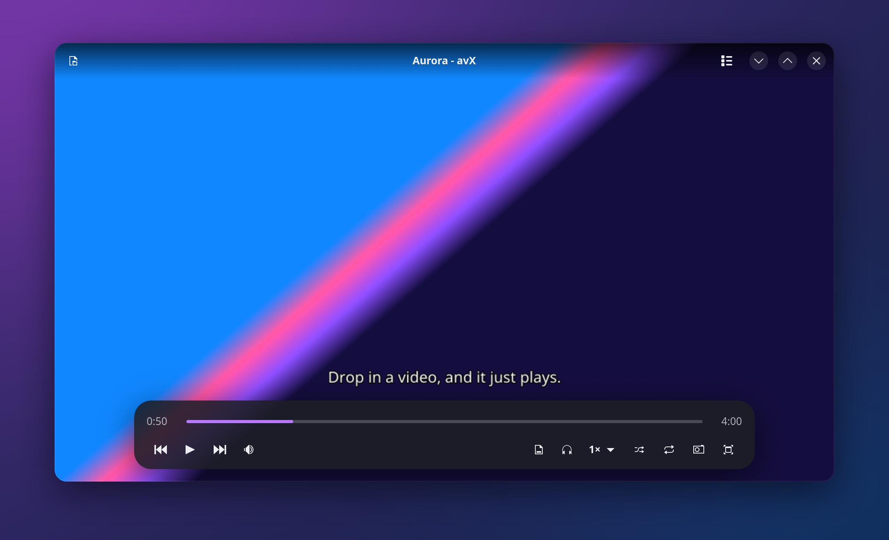
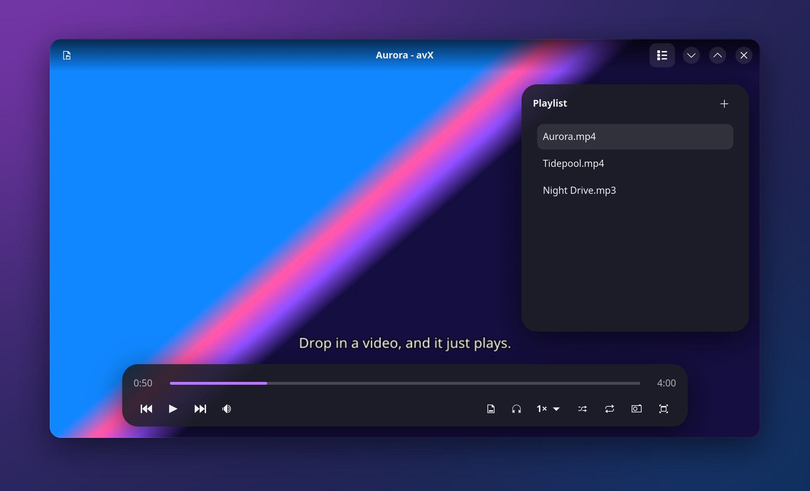
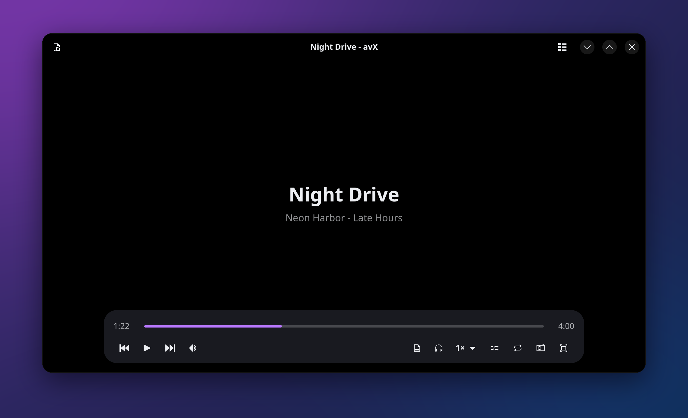

<p align="center">
  
</p>

<h1 align="center">avX</h1>

<p align="center">A clean, simple audio and video player for Linux.<br>Open a file and it plays.</p>

<p align="center">
  
</p>

## Install

Linux only for now. The installer takes care of everything it needs and adds avX to your app menu.

Download `install.sh` from the [latest release](https://github.com/siddharthvkutty/avx/releases/latest), make it executable, and run it:

```sh
curl -fsSL -o install.sh https://github.com/siddharthvkutty/avx/releases/latest/download/install.sh
chmod +x install.sh
./install.sh
```

The `chmod +x` step is required. Downloaded files aren't executable until you give them permission.

It will offer to make avX your default player for videos and music. Then open it from your app menu, or just double-click any video.

To update or uninstall, run `./install.sh` again and pick an option.

## Use

Drop a file on the window, or press `Ctrl+O`. Move the mouse to bring the controls up, and they tuck themselves away while you watch. Only a thin line stays at the bottom to show how far along you are.

Open a few files at once and they line up in a playlist.

<p align="center">
  
</p>

Music works too. You get the track and artist, and the same controls.

<p align="center">
  
</p>

## Features

- Plays almost any video or audio file
- Subtitles: load your own, pick a track, or nudge the timing
- Switch between audio tracks
- Playlist with repeat and shuffle
- Slow down or speed up playback
- Remembers where you stopped
- Screenshots of any frame, saved to your Pictures folder
- Fullscreen with a double-click

Handy keys: `Space` plays and pauses, the arrow keys skip and change the volume, `F` goes fullscreen.

## Credits

Playback is powered by [mpv](https://mpv.io).
